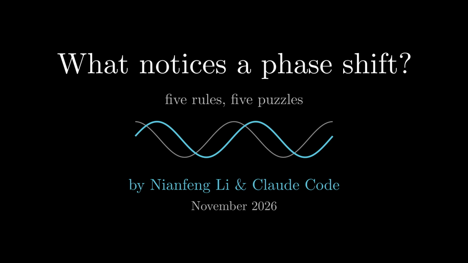
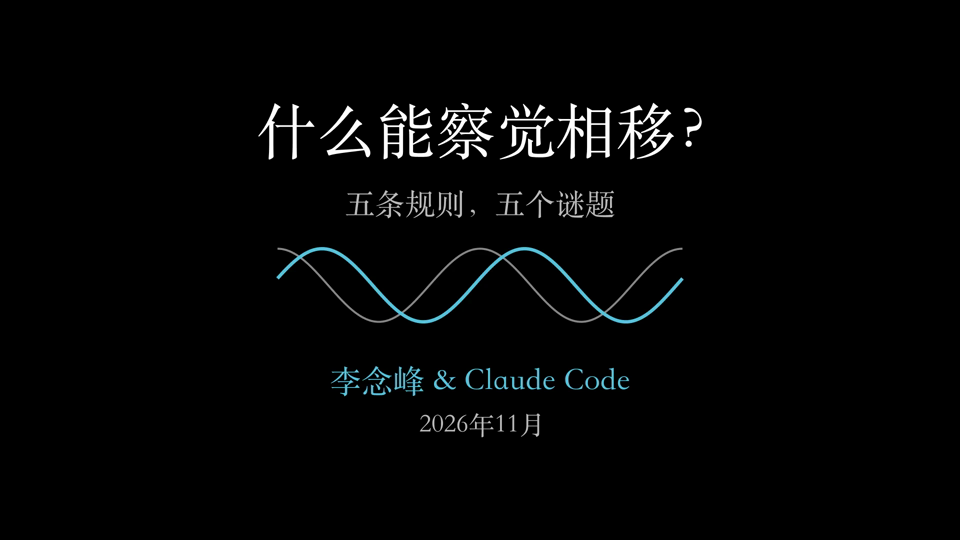

# What notices a phase shift?

An 8-minute explainer video in the 3Blue1Brown style, in **English and Chinese (simplified)**.
It is made with [Manim](https://www.manim.community/) and a local neural voice (Kokoro), and it includes demo
sounds you can hear. Everything runs offline, from this code.

By **Nianfeng Li (李念峰) and Claude Code**, November 2026. MIT License.

| English | 中文 |
|---|---|
|  |  |
| [phase_explained.mp4](https://github.com/WU6P/phase_video/releases/download/v1.0/phase_explained.mp4) (8 min 17 s, 1080p60) + [.srt](https://github.com/WU6P/phase_video/releases/download/v1.0/phase_explained.srt) | [phase_explained_zh.mp4](https://github.com/WU6P/phase_video/releases/download/v1.0/phase_explained_zh.mp4)（8 分 46 秒，1080p60）+ [.srt](https://github.com/WU6P/phase_video/releases/download/v1.0/phase_explained_zh.srt) |

Both MP4 files have soft subtitles in their own language. The videos are on the
[Releases page](https://github.com/WU6P/phase_video/releases), not in the git tree.

## What the video shows

Take a pure tone and slide it in time: that is a phase shift. Your ear mostly cannot tell, your eye cannot,
and an AM radio or a Morse receiver cannot. But a QAM modem fails after a few degrees. The video opens with
five puzzles, finds five rules, and at the end answers each puzzle with a rule.

| Scene | Content | Rule |
|---|---|---|
| Intro | Cover. A sine slides by φ: who can tell? Five puzzles | — |
| Phasor | A spinning arrow and its shadow. φ depends on when the clock starts; Δφ does not | 1 Only phase differences are measurable |
| Light | A detector reads length² (a turning square of constant area). Two beams add before the square: \|A+B\|², fringes | 2 Square-law detectors are blind to phase |
| Kinds | Six cosine-phase harmonics make a spike. Phase on a line through zero = a delay; +90° on all = a new shape, same magnitudes | 3 Phase linear in frequency is only a delay |
| Ear | **Sound:** harmonics 1–6 of 200 Hz, cosine vs random phase (≈ the same). The cochlea as a filter bank. **Sound:** harmonics 20–30 of 100 Hz (cosine phase buzzes) | 4 Components in different bands cannot interfere |
| Window | Fourier swap: magnitudes of picture 1 + phases of picture 2 looks like 2. In a window, magnitudes = what, phases = where. **Sound:** Morse with noise phases in 32 ms windows (rhythm kept) vs one window (timing gone) | — |
| Radio | The AM envelope ignores θ. QPSK / 16-QAM / 64-QAM rotate: first errors at 45°, 16.9°, 7.7°. Pilots and differential coding | 5 Phase-coded data needs a reference |
| Outro | The five rules, the five puzzles answered, two questions to ask. End card: link, QR code, credits | — |

## Setup

Requirements: Python 3.13, `ffmpeg`/`ffprobe`, and the Cairo/Pango libraries for Manim (macOS: `brew install
cairo pango ffmpeg`). Node.js is optional (used by `test_dsp.py` only).

```
python3.13 -m venv .venv
.venv/bin/pip install -r requirements.txt
.venv/bin/pip install --ignore-requires-python "misaki[zh]==0.9.4"     # Chinese voice only
```

Downloads that are not in the repository:

- `models/` (Kokoro voices, from the [kokoro-onnx releases](https://github.com/thewh1teagle/kokoro-onnx/releases)):
  `kokoro-v1.0.onnx` and `voices-v1.0.bin` (release `model-files-v1.0`) for English;
  `kokoro-v1.1-zh.onnx` and `voices-v1.1-zh.bin` (release `model-files-v1.1`) and
  [`config.json`](https://huggingface.co/hexgrad/Kokoro-82M-v1.1-zh/raw/main/config.json) saved as
  `config-v1.1-zh.json` for Chinese.
- `fonts/`: `cmunrm.otf`, `cmunbx.otf`, `cmunti.otf`, `cmuntt.otf` (Computer Modern Unicode, from the
  [cm-unicode](https://cm-unicode.sourceforge.io/) package). The Chinese version uses the macOS font Songti SC.

## Build

`VLANG=zh` selects the Chinese version (the default is `en`). Each language has its own `audio*/`, `timing*/` and
`media*/` folders, so the two builds never overwrite each other.

```
.venv/bin/python dsp.py                    # assets/: demo sounds, pictures, spectrograms, numbers.json
.venv/bin/python test_dsp.py               # checks the signal processing and every number the narration states
VLANG=zh .venv/bin/python tts.py           # narration -> audio_zh/*.wav (cached per sentence)
VLANG=zh .venv/bin/python asr_check.py     # optional: speech recognition round trip (needs a local ASR server)
VLANG=zh ./render_all.sh                   # 8 scenes in parallel, 1080p60, about 2.5 min (Q=-ql: 35 s preview)
VLANG=zh .venv/bin/python sheet.py 480p15 Intro Ear   # contact sheets: one frame per sentence, for layout review
VLANG=zh .venv/bin/python assemble.py      # concat + rebuilt sound track + subtitles -> out/phase_explained_zh.mp4
VLANG=zh .venv/bin/python verify.py        # independent checks on the finished file
```

## Files

| File | What it does |
|---|---|
| `narration.py`, `narration_zh.py` | The script: one entry per sentence (subtitle text, and the spoken text where the voice needs help). The same cue ids in both languages |
| `scenes.py` | One Manim `Scene` per chapter |
| `zh_text.py` | Chinese for every label on screen. A render stops if a label with English words has no translation |
| `common.py` | The look, the sync mechanism (`with self.cue(id) as d:`), demo sounds (`self.sfx`), the QR code |
| `lang.py` | Language selection and the folders for each language; the repository URL for the end card |
| `dsp.py` | Demo sounds and pictures; the windowed magnitude/phase swap (sqrt-Hann, hop W/2) |
| `tts.py` | Kokoro voice: `af_heart` (English), `zf_001` with misaki G2P (Chinese; acronyms spelled letter by letter) |
| `assemble.py` | Joins the scenes and rebuilds the sound track from the logged cue times |
| `verify.py` | Checks the finished video (below) |

## How the sync works

`with self.cue("l_2") as d:` adds that sentence's audio at the current scene time and makes the block last at
least the audio length plus a short pause. The animations inside the block use `d`. So each sentence starts when
its pictures start, by construction, in both languages, even though the Chinese sentences have other lengths.
Each scene logs its cue times to `timing*/<Scene>.json`, and `assemble.py` builds the final sound track from
those times.

## Checks

`verify.py` checks the finished MP4 without trusting the code that built it:

1. Streams present, audio and video lengths agree.
2. Every scene file's frame count matches its timing log.
3. Sync in the final file: a speech onset within 35 ms of every cue start (result: −23..+10 ms).
4. The same on Manim's own audio in each scene file, which Manim placed next to the frames it drew.
5. Every voice clip is found by cross-correlation in Manim's scene audio and in the final file (r > 0.99).
   This check was added after a bug: the Chinese scenes played the English clips while the Chinese durations
   drove the timing. The final file was correct and checks 3–4 passed, so only the content check sees it.
   A test with the wrong-language clips fails it (r 0.015).
6. Demo sounds: found in the final file and in Manim's scene audio, after a calibration of Manim's constant
   −20.5 ms AAC offset on the voice clips; they agree within 0.6 ms. The level is within 1 dB of the voice.
7. End card: the QR code in the last seconds of the video decodes to this repository's URL (OpenCV).
8. Subtitles: inside the video, no overlaps.

`test_dsp.py` checks the numbers the narration states: the crest factor √12, resolved and unresolved harmonics
(ERB), the swap and tile correlations, the Morse envelope scores, and the QAM first-error angles
45° − asin(boundary / corner radius) = 45.0°, 16.874°, 7.693° against a brute-force rotation. With the
companion `../phase` project present, it also compares the port with that project's `core.js` (max difference
1e-15); without it, those comparisons are skipped.

`asr_check.py` sends every narration clip through local speech recognition (Qwen3-ASR) and compares the
transcript with the script: English word error rate 0.4 %, Chinese character error rate 0.2 %.

## Traps hit

- Kokoro: "kwam's" was heard as "quads"; plain "QAM" reads correctly. "radio. An A.M." ran together.
- misaki 0.7.4 (the newest that pip allows on Python 3.13) has no `version="1.1"` Chinese front end; 0.9.4 works
  with `--ignore-requires-python`. English words inside Chinese text need an `en_callable`, and espeak reads a lone
  "A" as the article, so acronyms are spelled with a letter-name table.
- A font list such as `"CMU Serif, Songti SC"` does not make Pango use Songti for Chinese: it falls back to a heavy
  sans. Name `Songti SC` alone.
- Songti glyphs are taller than CMU at the same size: three labels that fitted in English collided in Chinese
  (found on the contact sheets).
- A cross-correlation at 16 kHz undersells 3 kHz content; the sound checks run at 48 kHz.
